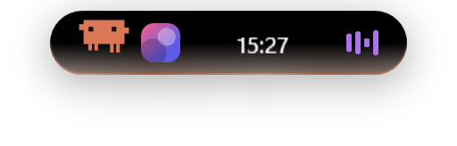
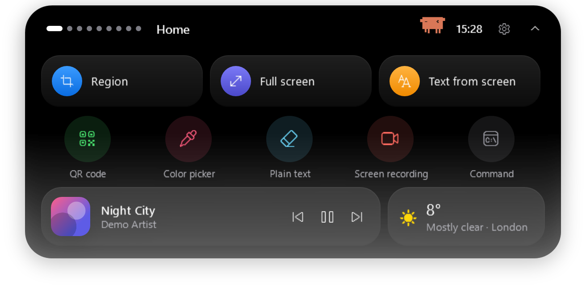
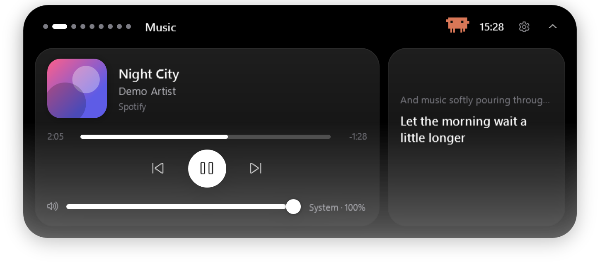
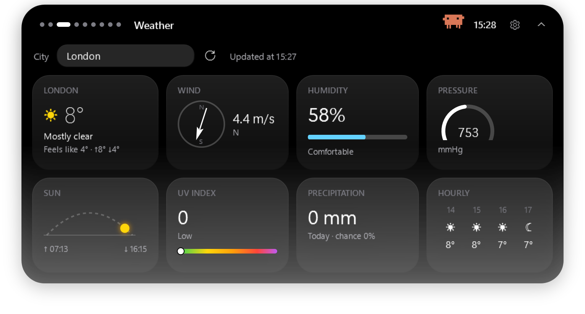
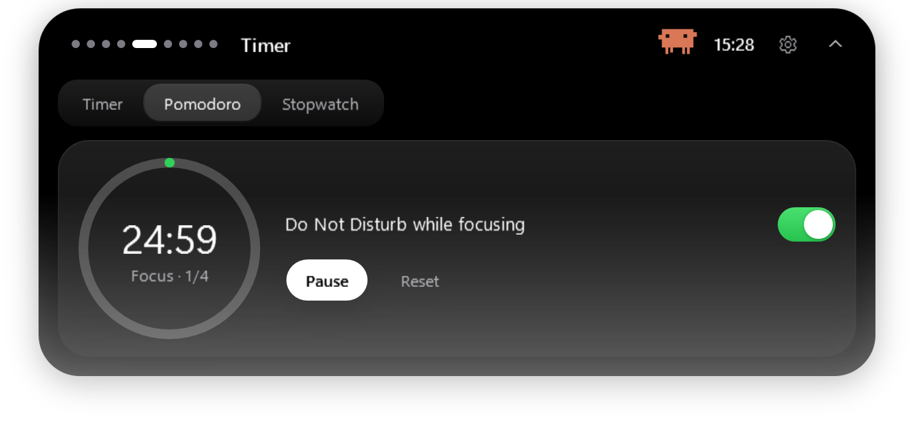
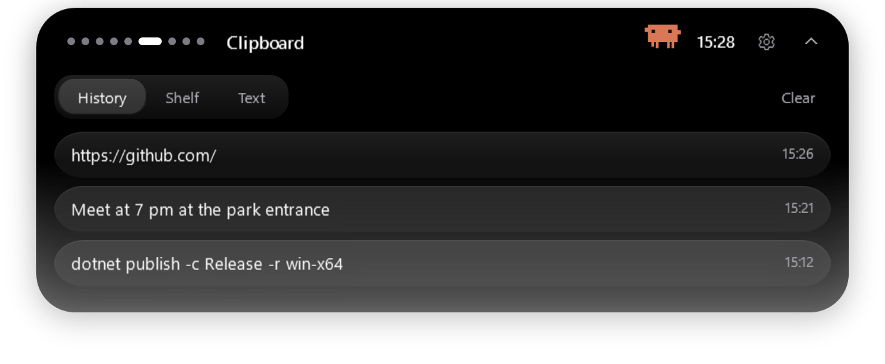
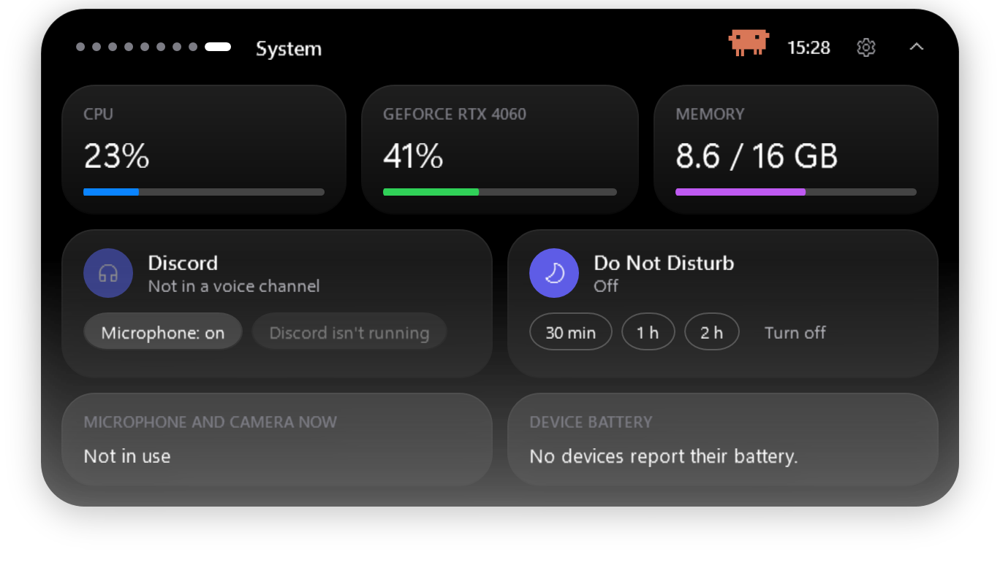

<div align="center">




# Atoll

### The Dynamic Island–style island for Windows

**The iPhone "island", reimagined for your PC.**
Music with live lyrics, weather, timers, screenshots with OCR and translation, an AI chat, clipboard history,
notes, a calendar, notifications and a little character that lives in the pill — all in one soft, springy island at the top of the screen.

**English** · [Русский](README.ru.md)

[](https://github.com/Fuwni/dynamic-island-windows/releases/latest)


[](LICENSE)

</div>

> 🌍 **7 languages:** English, Русский, Українська, Español, Deutsch, Português, 中文 — picked automatically from Windows,
> or in Settings → Behavior → Language.
>
> 🎬 **[Watch the 1.5-minute video tour](https://github.com/Fuwni/dynamic-island-windows/releases/download/v1.2.0/dynamic-island-review-ru.mp4)** (Russian voice-over).

---

## Contents

- [What's new in 1.6](#whats-new-in-16)
- [Features](#features)
- [Install (2 minutes, no admin rights)](#install)
- [How to use it](#how-to-use-it)
- [Keyboard shortcuts](#keyboard-shortcuts)
- [Characters](#characters)
- [Claude Code on the island](#claude-code-on-the-island)
- [Privacy and security](#privacy-and-security)
- [FAQ](#faq)
- [Build from source](#build-from-source)

---

## What's new in 1.6

- 🛠️ **1.6.1**: FPS in games without signing out, weather without a VPN, Caps Lock / layout no longer fold the island, NVIDIA recording works, a smoothness report.
- 📏 **Island size** from 80 to 130 %, and **lock in place** so it can't be dragged.
- 🙈 **Hide over chosen apps** (a windowed game, a call app) and a switch to **show or hide the island in screenshots** and screen sharing.
- ⌨️ **Caps Lock and keyboard layout** notices on the island.
- 📝 **Notes** keep long pasted texts in full; Shift+Enter for a new line.
- 💬 **Larger chat** so sign-in captchas fit. 🛡️ The **VPN tile** opens your VPN app (Happ, Hiddify, v2rayN, Amnezia…).

### Earlier, in 1.5

- 🪶 **Smoother**: steady 60 fps animations, a drag that follows the mouse, light graphics for weak PCs.
- 🎵 **Music**: a wave that moves with the sound, repeat for any player, ♥ favourites, Yandex Music.
- 🔀 **Several activities at once**: the mouse wheel over the pill switches between a call, the music, a timer…
- ⌨️ **Ctrl+Alt+O** opens the island. 🎨 **Themes**, an online theme gallery and your own photo.
- 🤖 **Codex** on the island and **9 AI assistants** in the chat.
- 🔒 Passwords from password managers stay out of the clipboard history.

### Earlier, in 1.4

- 🚀 **Apps on Home**: your favourite programs in one row at the bottom of the island. Press **+**, type a name, done (Microsoft Store apps too).
- 🎛️ **Control center**: Wi‑Fi, Bluetooth, airplane mode, VPN, battery, lock / sleep / restart / shut down.
- 🧹 **Clean desktop**: hide the desktop icons with one toggle; the taskbar stays.
- 🎮 **FPS in games**: the pill shows the game's frame rate with CPU / GPU load.
- 👆 **Click outside to close** the open island.

### Earlier, in 1.3

- ✨ **New name and logo — Atoll.** An atoll is a ring-shaped island: the mark is that ring, with one warm "live" dot in its lagoon. Minimal, and sharp even at 16 px in the tray.
- 🔄 **Automatic updates**: a notice on the island when a new version is out, one click to update (Settings → Behavior → Updates).
- 📦 **Installer and quick uninstall** (from 1.2.1): per-user setup with Start-menu entry and autostart, and *Settings → Behavior → Uninstall Atoll*.

### Earlier, in 1.2

- 🌍 **The interface speaks 7 languages**: English, Russian, Ukrainian, Spanish, German, Portuguese and Chinese. It follows your Windows language, and you can switch it in Settings → Behavior. Dates, units and quick reminders ("tomorrow 9:00", "in 20 min", "mañana 9:00", "明天 9:00") work in every language.
- 🎨 **New icon**: a violet squircle with the island, its little eyes and a warm glow.
- 🧰 Tools for making promo videos and screenshots straight from the app (`--snapshot`, `--brand`, `--promo`, `--review`, `--live-demo`).

### Earlier, in 1.1

The full list is in **[CHANGELOG.md](CHANGELOG.md)**. Highlights:

- 🧸 **15 characters** live in the pill *and* in the open menu, and react to what you do. **Click one** and it shows one of **7 emotions**.
- ✏️ **Hand-drawn mode**: characters animate frame by frame (12 fps) with a trembling ink outline.
- 🟠 **Claude** and **Claude Code** characters. Claude Code turns sideways, opens a laptop and types along when you write to the AI.
- 💧 **The island reaches for the cursor** with its whole body, opens with a soft blur and a tiny colour split, and lands with a little spring.
- 🧊 **Frosted glass** with adjustable tint, a see-through lower half and an idle **shimmering glow** (5 palettes).
- 📌 **Docked mode**: the island grows out of the top edge of the screen instead of floating.
- ⌨️ **Command bar** (`Alt+Space` / `Ctrl+Alt+Space`): launch apps, open sites, search, run actions.
- 🗂 **Shelf** for dropped files and **text tools** (fix wrong keyboard layout, change case, transliterate, clean up).
- 🔒 **Security hardening** and fixes: the city and AI chat logins survive a reboot, no more fake "in a Discord call".

---

## Features

<p align="center">
  
  
</p>
<p align="center">
  
  
</p>

**Collapsed**, the island shows the time and weather, and switches to a "live activity" when something happens:

| | |
|---|---|
| 🎵 **Music** | cover art and an equaliser; optionally the current lyric line right in the pill (karaoke) |
| ⏱ **Timer / Pomodoro / stopwatch** | progress ring and countdown |
| ⬇️ **Downloads** | file name and speed, a notice when it's done |
| 📅 **Calendar** | "Call · in 12 min" and a reminder 10 minutes before |
| 🎧 **Discord** | "in a channel" / "speaking" during a call |
| 🌙 **Do not disturb** | how much quiet time is left |
| 🎮 **Game mode** | CPU / GPU / RAM instead of hiding completely in games |
| 🟠🟢 **Mic and camera** | dots like on iPhone while something uses them |
| 💬 **Messages** | Telegram, Discord, Viber… pop up on the island with an unread counter |
| 🤖 **Claude Code** | permission requests with Allow / Deny buttons, "Claude finished" |

**Expanded**, there are 10 pages:

| Page | What it does |
|---|---|
| 🏠 Home | quick actions: region / full screenshot, text from screen (OCR), QR code, colour picker, clean text, screen recording, your own command; mini player and weather |
| 🎵 Music | any player that shows up in the Windows volume flyout (Spotify, browsers, Apple Music, AIMP, Winamp…); seek, per-app volume, synced lyrics from [LRCLIB](https://lrclib.net) |
| ☀️ Weather | type your city and press Enter: wind compass, humidity, pressure, sun arc, UV, rain, hourly forecast ([Open-Meteo](https://open-meteo.com), no key needed) |
| 💬 Chat | Claude, Gemini or DeepSeek inside the island; sign in once, no API keys |
| ⏱ Timer | timer, Pomodoro (can turn on Do Not Disturb), stopwatch |
| 📋 Clipboard | last 30 copied items (text, images, files), the file shelf and text tools; kept in memory only |
| 📝 Notes | quick notes; Enter saves, Shift+Enter is a new line |
| 📅 Calendar | reminders in plain words (`18:30`, `tomorrow 9:00`, `in 20 min` and the same in every language) and your Google / Outlook calendar via a private ICS link |
| 🖥 System | CPU / GPU / RAM, Discord mic & deafen, Do Not Disturb for 30 min / 1 h / 2 h, who uses mic and camera, battery of devices that report it |
| ⚙️ Settings | look, character, home layout, behaviour, actions, Claude Code |

**Also:** a screenshot editor with pen, marker, eraser, OCR, translation and QR; drag a file onto the island to share, zip or convert it;
drag the island anywhere or **flick it up** to hide it; it hides itself in games and fullscreen video; dark and light themes, 10 colours or your own.

<p align="center">
  
  
</p>

---

<a id="install"></a>
## Install (2 minutes, no admin rights)

**Installer (recommended)**

1. Open **[Releases](https://github.com/Fuwni/dynamic-island-windows/releases/latest)** and download **`DynamicIsland-…-setup.exe`**.
2. Run it. It installs just for you (no admin rights), adds Atoll to the Start menu and can start it with Windows.
3. Windows may show a blue **"Windows protected your PC"** window because the app isn't signed with a paid certificate.
   Click **More info → Run anyway**. You only need to do this once.

**Portable (no installation)**: download `DynamicIsland-…-win-x64.zip`, unzip it anywhere and run `DynamicIsland.exe`.

> You don't need to install .NET: everything is included.

**Requirements**

| What | Why | Where |
|---|---|---|
| Windows 10 (2004+) or 11, 64-bit | — | — |
| Microsoft Edge WebView2 Runtime | the Chat page | already in Windows 11; otherwise [download](https://developer.microsoft.com/microsoft-edge/webview2/) |
| Visual C++ Redistributable 2015–2022 (x64) | screen recording | usually installed; otherwise [download](https://aka.ms/vs/17/release/vc_redist.x64.exe) |

**Update:** run the new setup over the old one. Your settings are kept.

**Uninstall (10 seconds):** **Settings → Behavior → Uninstall Atoll**, or Windows **Settings → Apps → Installed apps → Atoll → Uninstall**.
It removes the app, its Start-menu entry, autostart and Claude Code hooks, and asks whether to delete your settings, notes and chat logins too.
The same button works for the portable version: it cleans up and deletes its own folder.

---

## How to use it

| Do this | What happens |
|---|---|
| Hover the island | it opens (or on click — see Settings) |
| Move the mouse away | it folds back |
| **Drag** it | it moves anywhere and remembers the spot |
| **Flick up** | it hides; a thin strip stays at the top |
| Click / pull the strip | it comes back |
| **Click the character** | it shows a random emotion 🙂 |
| Right-click | menu: hide, theme, settings, exit |
| Drop a file on it | file actions |

## Keyboard shortcuts

| Keys | Action |
|---|---|
| `Ctrl` + `Alt` + `I` | show / hide the island |
| `Ctrl` + `Alt` + `S` | screenshot of a region |
| `Ctrl` + `Alt` + `R` | start / stop screen recording |
| `Ctrl` + `Alt` + `T` | dark ↔ light theme |
| `Alt` + `Space` or `Ctrl` + `Alt` + `Space` | command bar |

In the screenshot editor: `Ctrl+Z` undo, `Ctrl+C` copy, `Ctrl+S` save, `Esc` close.

---

## Characters

<p align="center"></p>

Pick one in **Settings → Character**. It lives in the collapsed pill and in the header of the open menu, and it:

- follows the cursor with its eyes and blinks;
- dances to music, thinks while Claude Code works and falls asleep when you're away;
- hops when you press buttons or switch pages, cheers when you switch something on, types along when you type;
- greets you when the menu opens.

**Click it** for one of seven emotions: love, anger, surprise, sadness, dizziness, laughter or cool sunglasses.

<p align="center"></p>

**Claude** is the orange starburst: its rays stretch and pull back in a wave and it never spins.
**Claude Code** is the pixel mascot: when you write in the Chat page it hops onto the chat window, turns sideways, opens a laptop and types; when you stop it closes the lid and turns back.
Their orange under-glow can be turned off in the same settings section.

**Hand-drawn mode**: every character animates on twos with an ink outline that "boils" from frame to frame.

<p align="center"></p>

---

## Claude Code on the island

If you use [Claude Code](https://claude.com/claude-code), the island can show its permission requests
("wants to run `dotnet build`") with **Allow / Deny / In terminal** buttons and tell you when Claude has finished.

Turn it on: **Settings → Claude Code → Connect**. The island adds its hooks to `~/.claude/settings.json`
(a backup is kept next to it); **Disconnect** removes only its own entries.
If the island isn't running, Claude Code simply asks in the terminal as usual.

---

## Privacy and security

The island collects nothing and has no telemetry. Network requests happen only for features you can see:

| Feature | Where | What is sent |
|---|---|---|
| Weather | open-meteo.com | your city name / coordinates |
| Lyrics | lrclib.net | track title and artist |
| "Translate" in the screenshot editor | translate.googleapis.com | the recognised text, **only when you click** |
| Chat | the chat site you picked | what you type into the chat |
| Calendar | your ICS link | — |

OCR, QR codes, screen recording and the clipboard work **locally**. Settings and notes are in `%APPDATA%\DynamicIsland`,
chat logins in `%LOCALAPPDATA%\DynamicIsland\WebView2`, the error log in `%LOCALAPPDATA%\DynamicIsland\log.txt`.
Nothing personal is shipped in the release: a fresh install starts with no city, no accounts and default settings.

Security measures are described in **[SECURITY.md](SECURITY.md)**: a secret-protected local bridge for Claude Code, links limited to http/https,
and a chat that can't launch programs. Found a problem? Please report it as described there.

---

## FAQ

**Is it free?** Yes, completely: no subscription, no ads, MIT license.

**Is it safe / virus-free?** Yes. All the code is open in this repository, so you can read it or build it yourself. Atoll installs without admin rights.

**Is there a Linux or macOS version?** No, Windows 10 and 11 only: the app is built with WPF, a Windows technology.

**How much memory does it use?** Usually 250–400 MB, about a couple of browser tabs. On a weak PC turn on *Settings → Behavior → Light graphics* (no glass or glow; it turns on by itself on weak PCs).

**Does it need the internet?** Only for the weather, song lyrics and their translation, AI chats, updates and the theme gallery. Everything else works offline.

**How do I uninstall it?** *Settings → Behavior → Uninstall Atoll*, or *Windows Settings → Apps*.

**The blue "Windows protected your PC" window.** The app isn't signed with a paid certificate. Click *More info → Run anyway*.

**The island disappears in games.** That's on purpose ("Hide in games and full screen"). Turn on "In games, show FPS and load instead of hiding", and use "Hide the island over these apps" for windowed games.
Nothing can be drawn over *exclusive* fullscreen games; switch the game to borderless windowed.

**The island is missing from my screenshots.** By default it stays out of screenshots, recordings and screen sharing. Turn off *Settings → Behavior → Hide the island in screenshots and screen sharing*; the glass then turns solid, otherwise the island would photograph itself.

**My headset battery isn't shown.** Some headsets (for example Logitech G435) don't report battery to the PC at all — not even to the vendor's own app.

**I can't sign in to Gemini / Claude with Google.** Google sometimes blocks sign-in inside embedded windows. Sign in with email, or press ↗ to open the chat in your normal browser.

**Messenger notifications don't appear.** The messenger must show Windows notifications, and Windows must allow notification access.

**A shortcut doesn't work.** Another program already uses it; the reason is written to `%LOCALAPPDATA%\DynamicIsland\log.txt`.

---

## Build from source

You need the [.NET 10 SDK](https://dotnet.microsoft.com/download).

```bash
git clone https://github.com/Fuwni/dynamic-island-windows.git
cd dynamic-island-windows
dotnet run -c Release
```

A self-contained build to share (users don't need .NET):

```bash
dotnet publish -c Release -r win-x64 --self-contained true -o publish/DynamicIsland
```

The screenshots in this README are made by the app itself from demo data (no real accounts or locations):

```bash
DynamicIsland.exe --snapshot docs/screenshots
```

### Project layout

```
App.xaml               styles and shared resources (dark / light theme)
MainWindow.xaml        the island: compact view, notifications, all pages
MainWindow.*.cs        logic in parts: Media, Weather, Actions, Chat, Live, Tools, Liquid, Glass,
                       Command, TextShelf, Buddy, Settings, Claude, Demo
Views/                 characters, screenshot editor, region picker / colour picker, chromatic effect
Services/              music, weather, lyrics, capture and OCR, recording, calendar, notifications,
                       clipboard, system load, Do Not Disturb, Claude Code hooks and bridge, safe link opening
Assets/                icon and the Claude Code bridge script
```

Every push is built by GitHub Actions; the ready zip is under **Actions → artifacts**.

---

<div align="center">

Made with love for the little things · [MIT License](LICENSE)

</div>
