<div align="center">

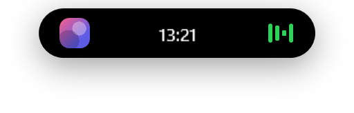

# Dynamic Island для Windows

**«Островок» как на iPhone — только на компьютере.**
Музыка со словами песен, погода, таймеры, скриншоты с переводом текста, чат с ИИ,
буфер обмена, заметки, календарь и уведомления — в одной аккуратной пилюле наверху экрана.

[](https://github.com/mykolaichechelnytskyi/dynamic-island-windows/releases/latest)


[](LICENSE)

</div>

---

## Содержание

- [Что умеет](#что-умеет)
- [Установка](#установка)
- [Как пользоваться](#как-пользоваться)
- [Горячие клавиши](#горячие-клавиши)
- [Вкладки по порядку](#вкладки-по-порядку)
- [Claude Code на острове](#claude-code-на-острове)
- [Приватность: что и куда отправляется](#приватность-что-и-куда-отправляется)
- [Частые вопросы](#частые-вопросы)
- [Сборка из исходников](#сборка-из-исходников)

---

## Что умеет

<p align="center">
  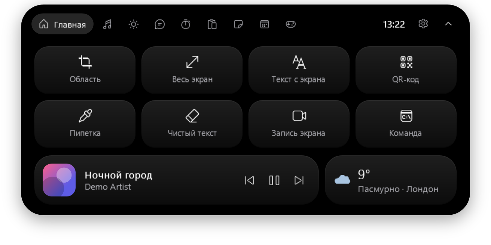
  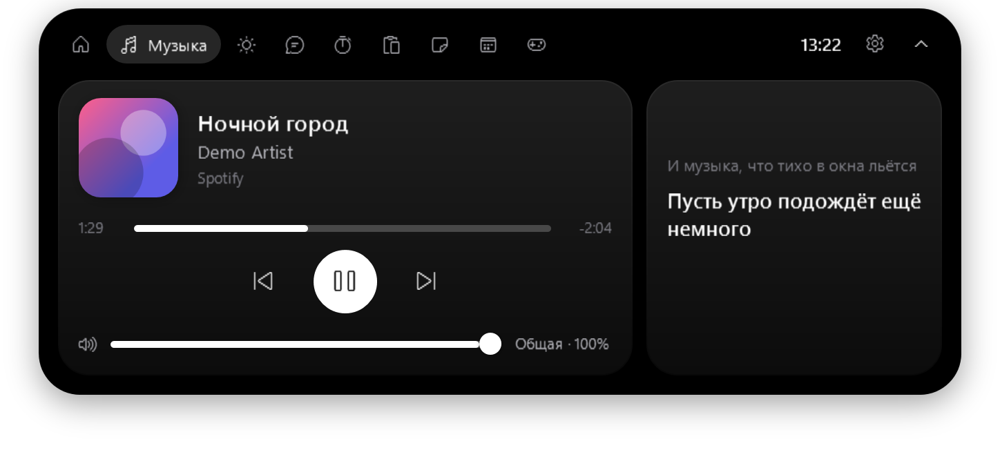
</p>
<p align="center">
  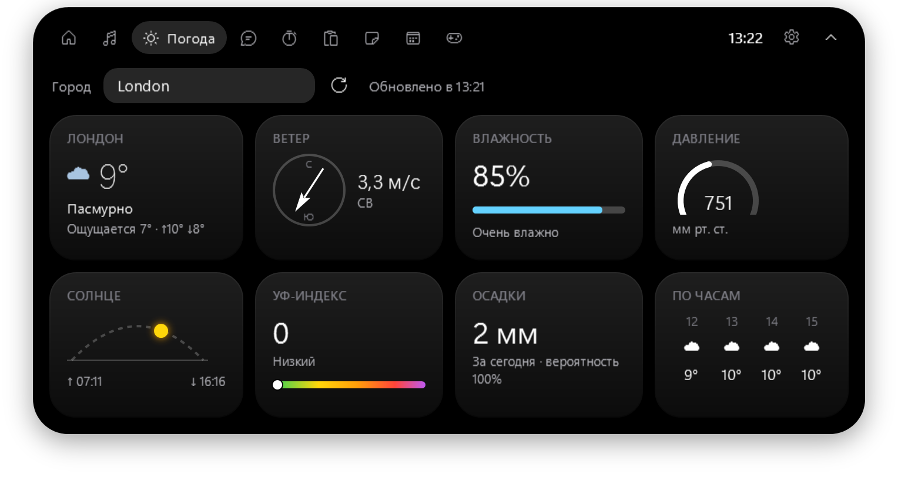
  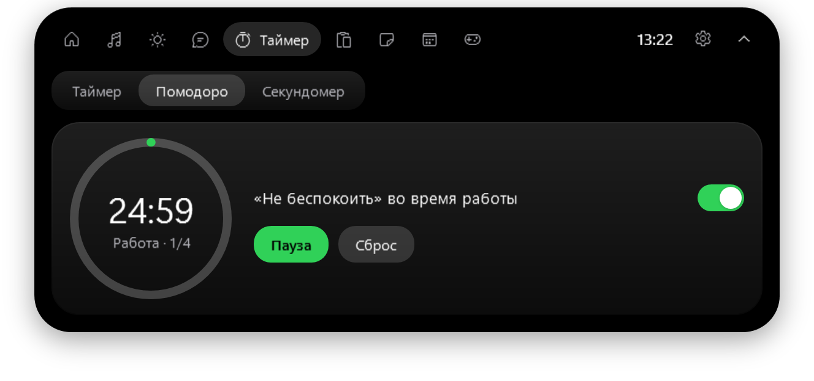
</p>

**В свёрнутом виде** остров показывает время и погоду, а когда что-то происходит — «живую активность»:

| | |
|---|---|
| 🎵 **Музыка** | обложка и эквалайзер; по желанию — строка песни прямо в пилюле (караоке) |
| ⏱ **Таймер / помодоро / секундомер** | кольцо прогресса и обратный отсчёт |
| ⬇️ **Загрузки** | имя файла и скорость, уведомление по окончании |
| 📅 **Календарь** | «Созвон · через 12 мин» и напоминание за 10 минут |
| 🎧 **Discord** | «в канале» / «говорят» во время звонка |
| 🌙 **Не беспокоить** | сколько осталось тишины |
| 🎮 **Игровой режим** | CPU / GPU / RAM вместо полного скрытия в игре |
| 🟠🟢 **Микрофон и камера** | точки, как на iPhone, когда их кто-то использует |
| 💬 **Сообщения** | Telegram, Discord, Viber… всплывают на острове, счётчик непрочитанных |

<p align="center">
  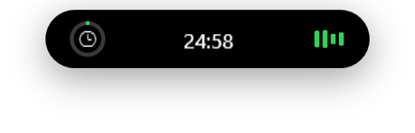
  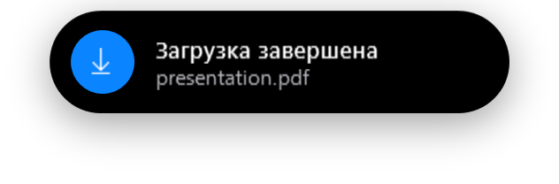
</p>

**В развёрнутом виде** — 10 вкладок: Главная, Музыка, Погода, Чат, Таймер, Буфер, Заметки, Календарь, Система и Настройки
(подробно — [ниже](#вкладки-по-порядку)).

**И ещё:**

- 📸 скриншот области или всего экрана → редактор: ручка, маркер, ластик, **распознать текст**, **перевести**, прочитать **QR-код**;
- 🎨 пипетка — цвет любого пикселя на экране в буфер (`#RRGGBB`);
- 🎬 запись экрана в MP4 **со звуком компьютера и микрофоном**;
- 📂 перетащите файл на остров → поделиться, сжать в ZIP, конвертировать или сжать картинку;
- 🖐 остров можно **двигать мышью** и **смахнуть вверх**, чтобы спрятать;
- 🕹 сам прячется в играх и при полноэкранном видео;
- 🌗 тёмная и светлая тема одной клавишей, 10 цветов острова или свой.

---

## Установка

### Вариант 1 — готовая программа (проще всего)

1. Откройте **[Releases](https://github.com/mykolaichechelnytskyi/dynamic-island-windows/releases/latest)** и скачайте `DynamicIsland-…-win-x64.zip`.
2. Распакуйте архив в удобную папку, например:
   ```
   %LOCALAPPDATA%\Programs\DynamicIsland
   ```
   (вставьте эту строку в адресную строку проводника — папка в вашем профиле, права администратора не нужны).
3. Запустите **`DynamicIsland.exe`**. Остров появится вверху экрана.
4. Windows может показать синее окно **«Windows защитила ваш компьютер»** — программа не подписана платным сертификатом.
   Нажмите **«Подробнее» → «Выполнить в любом случае»**. Это нужно один раз.
5. Чтобы остров запускался сам: правый клик по острову → **Настройки** → **«Запускать вместе с Windows»**.

> .NET ставить не нужно — всё уже внутри архива.

### Требования

| Что | Зачем | Где взять |
|---|---|---|
| Windows 10 (2004+) или Windows 11, 64-бит | — | — |
| Microsoft Edge WebView2 Runtime | вкладка «Чат» | в Windows 11 уже есть; иначе — [скачать](https://developer.microsoft.com/microsoft-edge/webview2/) |
| Visual C++ Redistributable 2015–2022 (x64) | запись экрана | обычно уже стоит; иначе — [скачать](https://aka.ms/vs/17/release/vc_redist.x64.exe) |

### Обновление и удаление

- **Обновить:** закройте остров (правый клик → «Выход»), замените файлы в папке новыми из свежего релиза.
- **Удалить:** выключите автозапуск в настройках, закройте остров и удалите папку программы.
  Настройки и заметки лежат в `%APPDATA%\DynamicIsland` — удалите и её, если не нужны.

---

## Как пользоваться

| Действие | Что произойдёт |
|---|---|
| Навести мышь на остров | раскроется панель (можно выключить в настройках — тогда по клику) |
| Клик по острову | раскрыть |
| Увести мышь | свернётся обратно |
| **Перетащить** | остров переедет куда угодно, позиция запомнится |
| **Смахнуть вверх** | спрячется; наверху останется тонкая полоска |
| Клик / потянуть вниз полоску | остров вернётся |
| Правый клик | меню: спрятать, тема, настройки, выход |
| Перетащить файл на остров | меню действий с файлом |
| Значок в трее | показать / спрятать, скриншот, тема, настройки |

## Горячие клавиши

| Клавиши | Действие |
|---|---|
| `Ctrl` + `Alt` + `I` | показать / спрятать остров |
| `Ctrl` + `Alt` + `S` | скриншот области |
| `Ctrl` + `Alt` + `R` | начать / остановить запись экрана |
| `Ctrl` + `Alt` + `T` | тёмная ↔ светлая тема |

В редакторе скриншота: `Ctrl+Z` — отменить, `Ctrl+C` — копировать, `Ctrl+S` — сохранить, `Esc` — закрыть.

---

## Вкладки по порядку

<details>
<summary><b>🏠 Главная</b> — быстрые действия, мини-плеер и погода</summary>

8 плиток: **Область**, **Весь экран**, **Текст с экрана** (распознать и скопировать), **QR-код**, **Пипетка**,
**Чистый текст** (убирает форматирование, лишние пробелы и невидимые символы из буфера), **Запись экрана**, **Команда** (запускает вашу команду из настроек).

Главную можно собрать под себя: Настройки → «Главная — соберите под себя».
Скриншоты сохраняются в `Изображения\Dynamic Island`, записи — в `Видео\Dynamic Island`.
</details>

<details>
<summary><b>🎵 Музыка</b> — любой плеер, слова песен, громкость</summary>

Работает со всем, что показывает музыку в системном окне громкости Windows: Spotify, Яндекс Музыка, YouTube и ВК в браузере, Apple Music, а также **AIMP** и **Winamp**.
Обложка, перемотка кликом по полосе, громкость **именно этого плеера**.
Синхронные слова песни подгружаются из открытой базы [LRCLIB](https://lrclib.net).
Если музыка стоит на паузе дольше 2 минут — остров её убирает.
</details>

<details>
<summary><b>☀️ Погода</b> — как в iPhone</summary>

Впишите свой город и нажмите Enter. Сейчас, ветер с компасом, влажность, давление (мм рт. ст.), солнце на своей дуге, УФ-индекс, осадки и прогноз по часам.
Данные — [Open-Meteo](https://open-meteo.com), без ключей и регистрации.
</details>

<details>
<summary><b>💬 Чат</b> — Claude, Gemini, DeepSeek</summary>

Сайты чатов открываются прямо в острове. Ключи не нужны — один раз войдите в свой аккаунт.
Кнопка ↗ откроет текущий чат в обычном браузере.
</details>

<details>
<summary><b>⏱ Таймер</b> — таймер, помодоро, секундомер</summary>

Пресеты от 1 минуты до часа или своё время. Помодоро: 25 минут работы / 5 перерыв, после 4 кругов — 15 минут;
может сам включать «Не беспокоить» на время работы. Отсчёт виден в свёрнутом острове.
</details>

<details>
<summary><b>📋 Буфер</b> — история копирования</summary>

Последние 30 скопированных текстов, картинок и файлов. Клик — и элемент вставится туда, где вы печатали.
Хранится только в памяти и исчезает после закрытия программы.
</details>

<details>
<summary><b>📝 Заметки</b></summary>

Напишите и нажмите Enter (`Shift+Enter` — новая строка). Клик по заметке копирует её. Сохраняются на диск.
</details>

<details>
<summary><b>📅 Календарь</b> — напоминания и ваш календарь</summary>

Быстрые напоминания понимают: `18:30`, `завтра 9:00`, `через 20 мин`, `через 2 ч`, `15.11 14:00`.
Можно подключить **Google / Outlook / Яндекс** календарь по секретной ICS-ссылке
(Google Календарь → Настройки календаря → «Секретный адрес в формате iCal»).
</details>

<details>
<summary><b>🎮 Система</b> — нагрузка, Discord, «Не беспокоить»</summary>

Загрузка процессора, видеокарты и памяти; статус Discord и кнопки «выключить микрофон» / «заглушить Discord»;
**«Не беспокоить»** на 30 минут, 1 или 2 часа (скрывает баннеры Windows и сам возвращает их обратно);
кто сейчас пользуется микрофоном и камерой; заряд беспроводных устройств, которые его сообщают.
</details>

<details>
<summary><b>⚙️ Настройки</b></summary>

Тема и цвет острова, «живые волны» (желеобразная анимация — по умолчанию выключена), какие блоки показывать на Главной,
раскрытие при наведении, скрытие в играх или игровой режим, караоке, уведомления мессенджеров, автозапуск,
команда для кнопки «Команда», язык перевода, звук при записи экрана, подключение Claude Code.
</details>

<p align="center">
  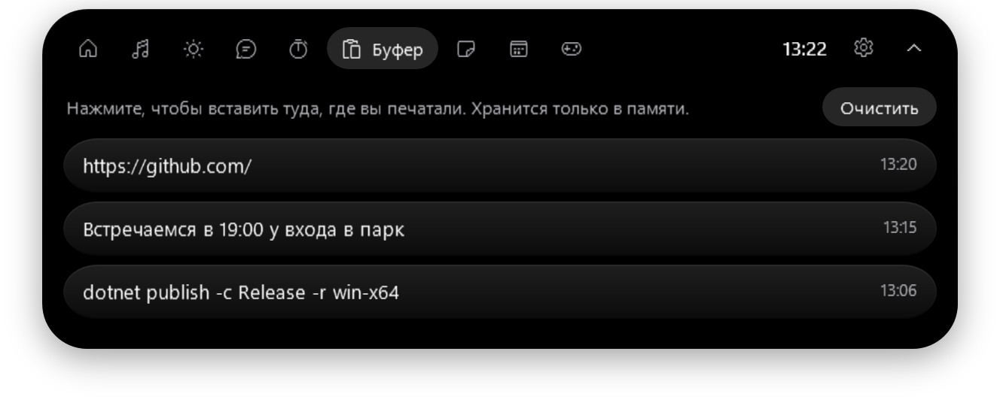
  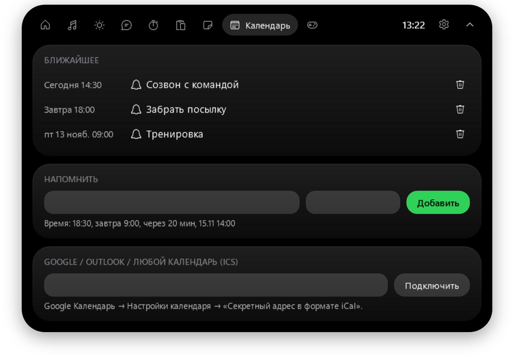
</p>
<p align="center">
  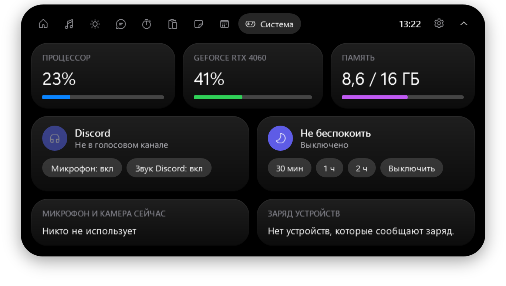
  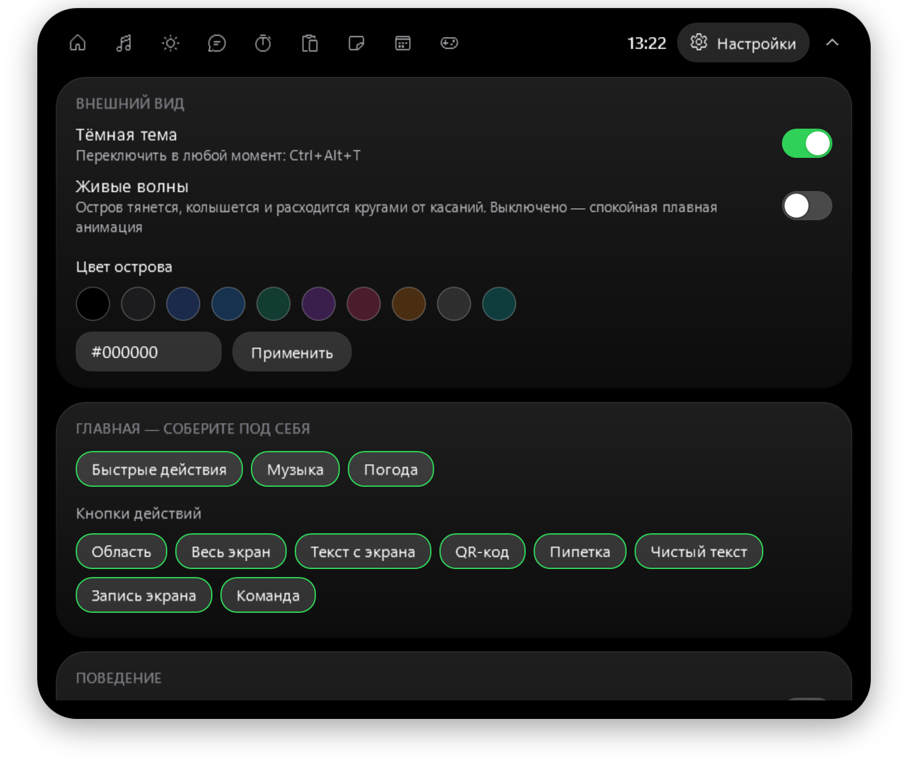
</p>

---

## Claude Code на острове

Если вы пользуетесь [Claude Code](https://claude.com/claude-code), остров может показывать его запросы разрешений
(«хочет выполнить `dotnet build`») с кнопками **Разрешить / Запретить / В терминале** и сообщать, когда Claude закончил работу.

Включение: **Настройки → Claude Code → «Подключить»**. Остров добавит свои хуки в `~/.claude/settings.json`
(рядом сохранится резервная копия), «Отключить» уберёт только их.
Если остров закрыт, Claude Code просто спросит в терминале, как обычно.

---

## Приватность: что и куда отправляется

Остров ничего не собирает и не отправляет «домой». Внешние запросы — только для функций, которые вы видите:

| Функция | Куда | Что уходит |
|---|---|---|
| Погода | open-meteo.com | название города / координаты |
| Слова песен | lrclib.net | название трека и исполнитель |
| «Перевести» в редакторе скриншота | translate.googleapis.com | распознанный текст — **только по нажатию** |
| Чат | сайт выбранного чата | то, что вы сами пишете в чат |
| Календарь | ваша ICS-ссылка | — |

Распознавание текста, QR-коды, запись экрана и буфер обмена работают **локально**.
Настройки и заметки — в `%APPDATA%\DynamicIsland`, журнал ошибок — в `%LOCALAPPDATA%\DynamicIsland\log.txt`.

---

## Частые вопросы

**Синее окно «Windows защитила ваш компьютер».**
Программа не подписана платным сертификатом. «Подробнее» → «Выполнить в любом случае».

**Остров не виден в игре.**
Так задумано — в играх и полноэкранном видео он прячется. Включите «игровой режим» в настройках, чтобы видеть CPU/GPU/RAM.
В играх с «эксклюзивным полноэкранным» режимом поверх ничего показать нельзя — переключите игру в «оконный без рамки».

**Не показывается заряд наушников.**
Некоторые гарнитуры (например, Logitech G435) вообще не передают заряд компьютеру — его не видит даже фирменная программа.
Остров показывает заряд только тех устройств, которые его сообщают.

**Не входит в Gemini / Claude через Google.**
Google иногда запрещает вход во встроенных окнах. Войдите по почте или нажмите ↗, чтобы открыть чат в обычном браузере.

**Сообщения мессенджеров не появляются.**
Мессенджер должен показывать уведомления Windows (в его настройках), а Windows — разрешать доступ к уведомлениям.

**Ctrl+Alt+S (или другое сочетание) не работает.**
Его уже заняла другая программа. Причина записывается в `%LOCALAPPDATA%\DynamicIsland\log.txt`.

---

## Сборка из исходников

Нужен [.NET 10 SDK](https://dotnet.microsoft.com/download).

```bash
git clone https://github.com/mykolaichechelnytskyi/dynamic-island-windows.git
cd dynamic-island-windows
dotnet run -c Release
```

Готовая версия для раздачи (всё включено, .NET у пользователя не нужен):

```bash
dotnet publish -c Release -r win-x64 --self-contained true -o publish/DynamicIsland
```

Скриншоты для этого README генерирует сама программа на демо-данных:

```bash
DynamicIsland.exe --snapshot docs/screenshots
```

### Устройство проекта

```
App.xaml                 стили и общие ресурсы (тёмная / светлая тема)
MainWindow.xaml          остров: свёрнутый вид, уведомления, все вкладки
MainWindow.*.cs          логика по частям: Media, Weather, Actions, Chat, Live, Tools, Liquid, Settings, Claude
Views/                   редактор скриншотов и выбор области / пипетка
Services/                музыка, погода, слова песен, захват экрана и OCR, запись, календарь,
                         уведомления, буфер, системная нагрузка, «Не беспокоить», хуки Claude Code
Assets/                  иконка и скрипт моста для Claude Code
```

Каждый push собирается в GitHub Actions — готовый архив лежит во вкладке **Actions → артефакты**.

---

<div align="center">

Сделано с любовью к мелочам · [MIT License](LICENSE)

</div>
