<div align="center">

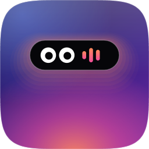

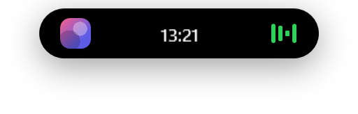

# Dynamic Island для Windows

**«Островок» как на iPhone — только на компьютере.**
Музыка со словами песен, погода, таймеры, скриншоты с распознаванием и переводом текста, чат с ИИ, буфер обмена,
заметки, календарь, уведомления и маленький персонаж, который живёт в пилюле, — в одном мягком, пружинистом острове наверху экрана.

[English](README.md) · **Русский**

🎬 **[Видео-обзор за полторы минуты](https://github.com/Fuwni/dynamic-island-windows/releases/download/v1.2.0/dynamic-island-review-ru.mp4)** · 🌍 7 языков интерфейса

[](https://github.com/Fuwni/dynamic-island-windows/releases/latest)


[](LICENSE)

</div>

---

## Содержание

- [Что нового в 1.2](#что-нового-в-12)
- [Что умеет](#что-умеет)
- [Установка за 2 минуты](#установка-за-2-минуты)
- [Как пользоваться](#как-пользоваться)
- [Горячие клавиши](#горячие-клавиши)
- [Персонажи](#персонажи)
- [Claude Code на острове](#claude-code-на-острове)
- [Приватность и безопасность](#приватность-и-безопасность)
- [Частые вопросы](#частые-вопросы)
- [Сборка из исходников](#сборка-из-исходников)

---

## Что нового в 1.2

- 🌍 **Интерфейс на 7 языках**: английский, русский, украинский, испанский, немецкий, португальский и китайский. Язык берётся из Windows, сменить можно в «Настройки → Поведение». Даты, единицы и быстрые напоминания («завтра 9:00», «через 20 мин», «tomorrow 9:00», «明天 9:00») понимаются на любом языке.
- 🎨 **Новая иконка**: фиолетовый «сквиркл» с островком, глазками и тёплым свечением.
- 🧰 Инструменты для промо-роликов и скриншотов прямо из приложения (`--snapshot`, `--brand`, `--promo`, `--review`, `--live-demo`).

### Раньше, в 1.1

Полный список — в **[CHANGELOG.md](CHANGELOG.md)**. Главное:

- 🧸 **15 персонажей** живут в пилюле *и* в открытом меню и реагируют на ваши действия. **Нажмите на персонажа** — он покажет одну из **7 эмоций**.
- ✏️ **Рисованный стиль**: персонажи двигаются покадрово (12 кадров в секунду) с «дрожащим» чернильным контуром.
- 🟠 Персонажи **Claude** и **Claude Code**. Claude Code поворачивается боком, открывает ноутбук и печатает, пока вы пишете ИИ.
- 💧 **Остров тянется к курсору** всем телом, открывается с мягким размытием и лёгким цветовым расслоением, приземляется с пружинкой.
- 🧊 **Матовое стекло** с настройкой оттенка, полупрозрачный низ и **переливающаяся подсветка** в покое (5 палитр).
- 📌 **Режим «У края»**: остров вырастает из верхнего края экрана, а не плавает.
- ⌨️ **Командная строка** (`Alt+Space` / `Ctrl+Alt+Space`): запуск программ, сайты, поиск, действия.
- 🗂 **Полка** для файлов и **инструменты текста** (исправить раскладку, регистр, транслит, очистка).
- 🔒 **Защита и исправления**: город и вход в нейросети больше не сбрасываются после перезагрузки, нет ложного «в канале Discord», закрыты уязвимости.

---

## Что умеет

<p align="center">
  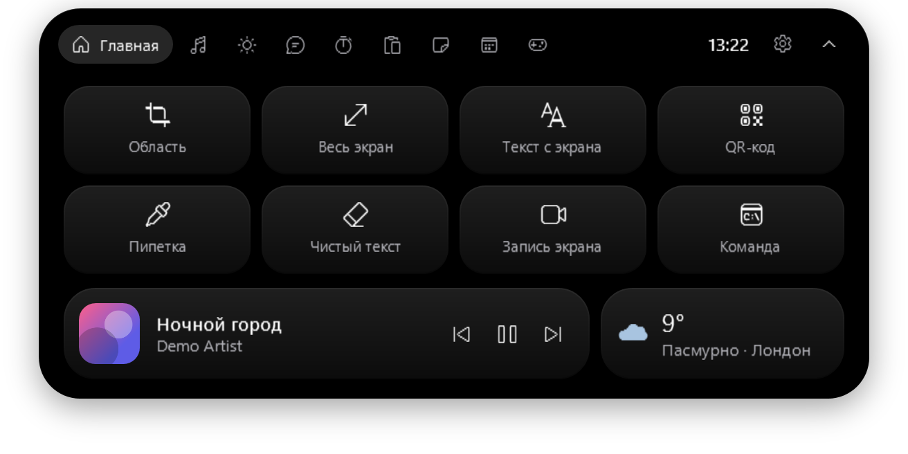
  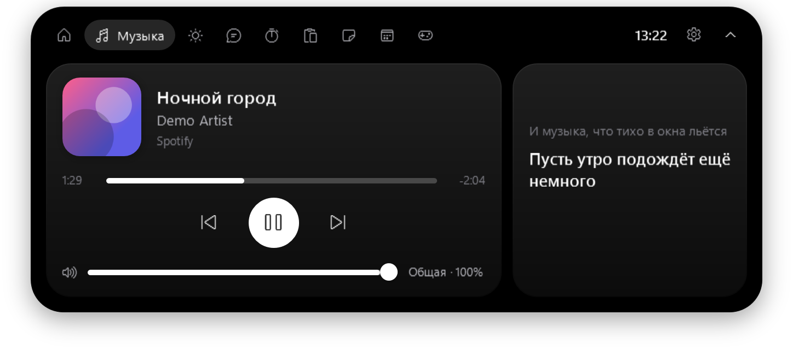
</p>
<p align="center">
  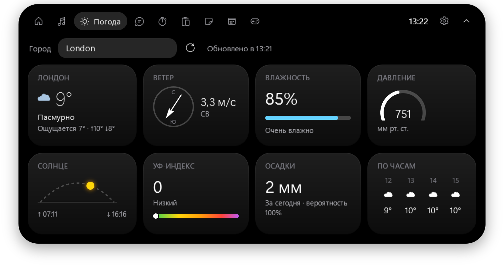
  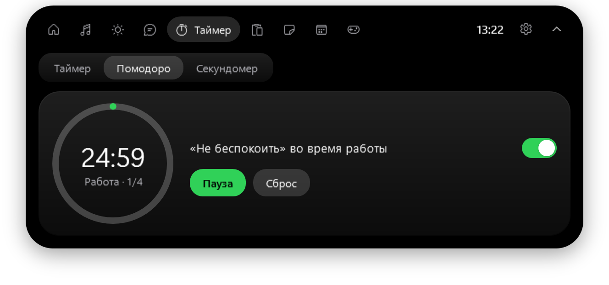
</p>

**В свёрнутом виде** остров показывает время и погоду, а когда что-то происходит — «живую активность»:

| | |
|---|---|
| 🎵 **Музыка** | обложка и эквалайзер; по желанию — строка песни прямо в пилюле (караоке) |
| ⏱ **Таймер / помодоро / секундомер** | кольцо прогресса и обратный отсчёт |
| ⬇️ **Загрузки** | имя файла и скорость, уведомление по окончании |
| 📅 **Календарь** | «Созвон · через 12 мин» и напоминание за 10 минут |
| 🎧 **Discord** | «в канале» / «говорят» во время звонка |
| 🌙 **Не беспокоить** | сколько осталось тишины |
| 🎮 **Игровой режим** | CPU / GPU / RAM вместо полного скрытия в игре |
| 🟠🟢 **Микрофон и камера** | точки, как на iPhone, когда их кто-то использует |
| 💬 **Сообщения** | Telegram, Discord, Viber… всплывают на острове, счётчик непрочитанных |
| 🤖 **Claude Code** | запросы разрешений с кнопками «Разрешить / Запретить», «Claude закончил» |

**В развёрнутом виде** — 10 вкладок:

| Вкладка | Что там |
|---|---|
| 🏠 Главная | быстрые действия: скриншот области / экрана, текст с экрана, QR-код, пипетка, чистый текст, запись экрана, своя команда; мини-плеер и погода |
| 🎵 Музыка | любой плеер из системного окна громкости (Spotify, Яндекс Музыка, браузеры, Apple Music, AIMP, Winamp…); перемотка, громкость именно этого плеера, слова песен из [LRCLIB](https://lrclib.net) |
| ☀️ Погода | впишите город и нажмите Enter: компас ветра, влажность, давление, солнце на дуге, УФ, осадки, прогноз по часам ([Open-Meteo](https://open-meteo.com), без ключей) |
| 💬 Чат | Claude, Gemini или DeepSeek прямо в острове; один раз войдите, ключи не нужны |
| ⏱ Таймер | таймер, помодоро (может включать «Не беспокоить»), секундомер |
| 📋 Буфер | последние 30 скопированных текстов, картинок и файлов, полка и инструменты текста; хранится только в памяти |
| 📝 Заметки | Enter — сохранить, Shift+Enter — новая строка |
| 📅 Календарь | напоминания словами (`18:30`, `завтра 9:00`, `через 20 мин`) и ваш Google / Outlook / Яндекс календарь по секретной ICS-ссылке |
| 🖥 Система | нагрузка CPU / GPU / RAM, микрофон и звук Discord, «Не беспокоить» на 30 мин / 1 ч / 2 ч, кто использует микрофон и камеру, заряд устройств |
| ⚙️ Настройки | внешний вид, персонаж, главная, поведение, действия, Claude Code |

**И ещё:** редактор скриншотов (ручка, маркер, ластик, распознать и перевести текст, QR); перетащите файл на остров — поделиться, сжать в ZIP, конвертировать;
остров можно двигать мышью и **смахнуть вверх**, чтобы спрятать; сам прячется в играх и полноэкранном видео; тёмная и светлая тема, 10 цветов или свой.

<p align="center">
  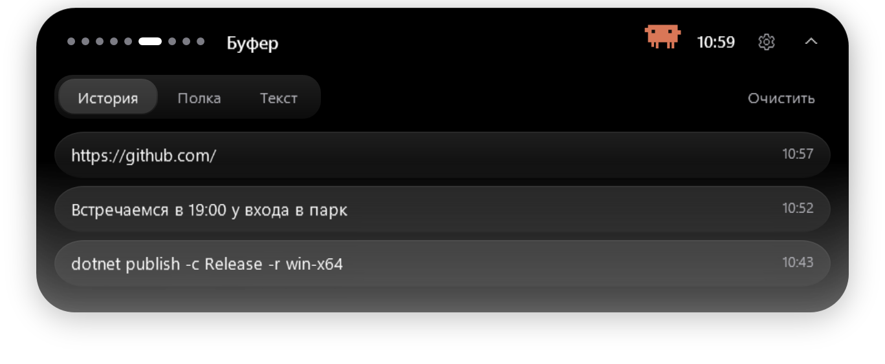
  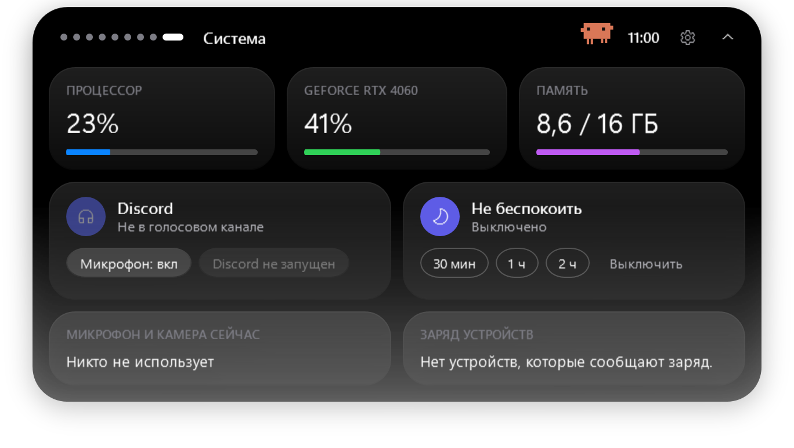
</p>

---

## Установка за 2 минуты

Права администратора не нужны.

1. Откройте **[Releases](https://github.com/Fuwni/dynamic-island-windows/releases/latest)** и скачайте `DynamicIsland-…-win-x64.zip`.
2. Распакуйте в удобную папку, например вставьте в адресную строку проводника:
   ```
   %LOCALAPPDATA%\Programs\DynamicIsland
   ```
3. Запустите **`DynamicIsland.exe`** — остров появится вверху экрана.
4. Windows может показать синее окно **«Windows защитила ваш компьютер»**: программа не подписана платным сертификатом.
   Нажмите **«Подробнее» → «Выполнить в любом случае»**. Это нужно один раз.
5. Автозапуск: правый клик по острову → **Настройки → Поведение → «Запускать вместе с Windows»**.

> .NET ставить не нужно — всё уже внутри архива.

**Требования**

| Что | Зачем | Где взять |
|---|---|---|
| Windows 10 (2004+) или 11, 64-бит | — | — |
| Microsoft Edge WebView2 Runtime | вкладка «Чат» | в Windows 11 уже есть; иначе — [скачать](https://developer.microsoft.com/microsoft-edge/webview2/) |
| Visual C++ Redistributable 2015–2022 (x64) | запись экрана | обычно уже стоит; иначе — [скачать](https://aka.ms/vs/17/release/vc_redist.x64.exe) |

**Обновить:** закройте остров (правый клик → «Выход») и замените файлы новыми из релиза — настройки сохранятся.
**Удалить:** выключите автозапуск, закройте остров, удалите папку. Настройки и заметки — в `%APPDATA%\DynamicIsland`, удалите и её, если не нужны.

---

## Как пользоваться

| Действие | Что произойдёт |
|---|---|
| Навести мышь | раскроется (или по клику — см. настройки) |
| Увести мышь | свернётся |
| **Перетащить** | переедет куда угодно и запомнит место |
| **Смахнуть вверх** | спрячется; наверху останется тонкая полоска |
| Клик / потянуть полоску | вернётся |
| **Клик по персонажу** | случайная эмоция 🙂 |
| Правый клик | меню: спрятать, тема, настройки, выход |
| Перетащить файл на остров | действия с файлом |

## Горячие клавиши

| Клавиши | Действие |
|---|---|
| `Ctrl` + `Alt` + `I` | показать / спрятать остров |
| `Ctrl` + `Alt` + `S` | скриншот области |
| `Ctrl` + `Alt` + `R` | начать / остановить запись экрана |
| `Ctrl` + `Alt` + `T` | тёмная ↔ светлая тема |
| `Alt` + `Space` или `Ctrl` + `Alt` + `Space` | командная строка |

В редакторе скриншота: `Ctrl+Z` — отменить, `Ctrl+C` — копировать, `Ctrl+S` — сохранить, `Esc` — закрыть.

---

## Персонажи

<p align="center">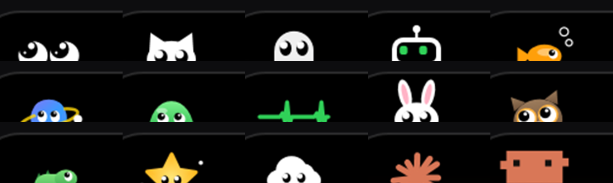</p>

Выбираются в **Настройки → Персонаж**. Персонаж живёт в свёрнутой пилюле и в шапке открытого меню:

- следит глазами за курсором и моргает;
- танцует под музыку, думает, пока работает Claude Code, засыпает, когда вас нет;
- подпрыгивает от нажатий и смены страниц, радуется, когда вы что-то включаете, печатает вместе с вами;
- здоровается, когда открывается меню.

**Нажмите на него** — покажет одну из семи эмоций: влюблённость, злость, удивление, грусть, головокружение, смех или крутые очки.

<p align="center">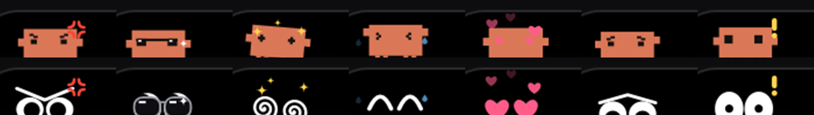</p>

**Claude** — оранжевая «искра»: лучи волной вытягиваются и втягиваются, сама не крутится.
**Claude Code** — пиксельный маскот: когда пишете во вкладке «Чат», он запрыгивает на окно чата, поворачивается боком, открывает ноутбук и печатает; перестали — закрывает крышку и поворачивается обратно.
Их оранжевую подсветку можно выключить там же.

**Нарисовано от руки (покадрово)**: все персонажи двигаются «через кадр», с чернильным контуром, который чуть дрожит от кадра к кадру.

<p align="center">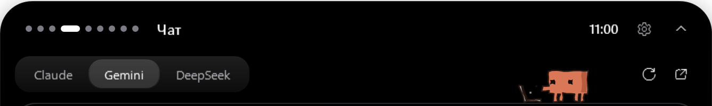</p>

---

## Claude Code на острове

Если вы пользуетесь [Claude Code](https://claude.com/claude-code), остров покажет его запросы разрешений
(«хочет выполнить `dotnet build`») с кнопками **Разрешить / Запретить / В терминале** и сообщит, когда Claude закончил.

Включение: **Настройки → Claude Code → «Подключить»**. Остров добавит свои хуки в `~/.claude/settings.json`
(рядом сохранится резервная копия), «Отключить» уберёт только их. Если остров закрыт, Claude Code спросит в терминале, как обычно.

---

## Приватность и безопасность

Остров ничего не собирает, телеметрии нет. Внешние запросы — только для функций, которые вы видите:

| Функция | Куда | Что уходит |
|---|---|---|
| Погода | open-meteo.com | город / координаты |
| Слова песен | lrclib.net | название трека и исполнитель |
| «Перевести» в редакторе скриншота | translate.googleapis.com | распознанный текст — **только по нажатию** |
| Чат | сайт выбранного чата | то, что вы сами пишете |
| Календарь | ваша ICS-ссылка | — |

Распознавание текста, QR, запись экрана и буфер работают **локально**. Настройки и заметки — в `%APPDATA%\DynamicIsland`,
вход в чаты — в `%LOCALAPPDATA%\DynamicIsland\WebView2`, журнал ошибок — `%LOCALAPPDATA%\DynamicIsland\log.txt`.
В релиз не попадает ничего личного: новая установка начинается без города, без аккаунтов и с настройками по умолчанию.

Меры защиты описаны в **[SECURITY.md](SECURITY.md)**: локальный мост Claude Code с секретным ключом, ссылки открываются только http/https,
чат не может запускать программы. Нашли проблему — сообщите, как там написано.

---

## Частые вопросы

**Синее окно «Windows защитила ваш компьютер».** Программа не подписана платным сертификатом: «Подробнее» → «Выполнить в любом случае».

**Остров не виден в игре.** Так задумано. Включите игровой режим в настройках, чтобы видеть CPU/GPU/RAM.
Поверх игр в «эксклюзивном полноэкранном» режиме ничего показать нельзя — переключите игру в «оконный без рамки».

**Острова нет на моих скриншотах.** Когда включено матовое стекло, остров прячется от захвата экрана (иначе стекло фотографировало бы само себя). Выключите стекло, если нужно.

**Не показывается заряд наушников.** Некоторые гарнитуры (например, Logitech G435) вообще не передают заряд компьютеру — его не видит даже фирменная программа.

**Не входит в Gemini / Claude через Google.** Google иногда запрещает вход во встроенных окнах. Войдите по почте или нажмите ↗, чтобы открыть чат в браузере.

**Сообщения мессенджеров не появляются.** Мессенджер должен показывать уведомления Windows, а Windows — разрешать доступ к уведомлениям.

**Сочетание клавиш не работает.** Его заняла другая программа; причина записана в `%LOCALAPPDATA%\DynamicIsland\log.txt`.

---

## Сборка из исходников

Нужен [.NET 10 SDK](https://dotnet.microsoft.com/download).

```bash
git clone https://github.com/Fuwni/dynamic-island-windows.git
cd dynamic-island-windows
dotnet run -c Release
```

Версия для раздачи (всё включено, .NET у пользователя не нужен):

```bash
dotnet publish -c Release -r win-x64 --self-contained true -o publish/DynamicIsland
```

Скриншоты для README делает сама программа на демо-данных (без настоящих аккаунтов и мест):

```bash
DynamicIsland.exe --snapshot docs/screenshots
```

Устройство проекта и остальное — в [английском README](README.md#project-layout). Каждый push собирается в GitHub Actions — готовый архив во вкладке **Actions → артефакты**.

---

<div align="center">

Сделано с любовью к мелочам · [MIT License](LICENSE)

</div>
